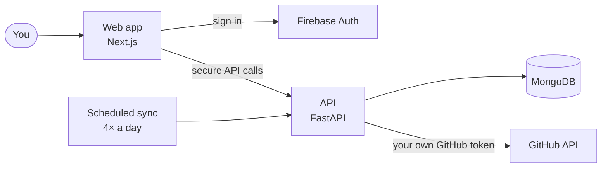

<div align="center">

# GitPulse

**GitHub forgets. GitPulse doesn't.**

Long-term GitHub traffic history, follower tracking and repository insights, on one dashboard.

[](https://gitpulse.vercel.app)
[](https://github.com/KalyanM45/GitPulse/stargazers)
[](https://github.com/KalyanM45/GitPulse/issues)
[](LICENSE)

[Live demo](https://gitpulse.vercel.app) · [Documentation](docs/README.md) · [Report a bug](https://github.com/KalyanM45/GitPulse/issues)

</div>

---

## Table of contents

- [About](#about)
- [Features](#features)
- [How it works](#how-it-works)
- [Tech stack](#tech-stack)
- [Documentation](#documentation)
- [Project structure](#project-structure)
- [Getting started](#getting-started)
- [Contributing](#contributing)
- [License](#license)

## About

GitHub only keeps **14 days** of repository traffic, and it keeps no record of
**who followed or unfollowed you**. GitPulse fills that gap. It syncs your account
several times a day and stores everything day by day, so your history keeps
growing long after GitHub has forgotten it.

GitPulse is in **invite-only beta**:

- **Anyone** can explore a live, read-only demo of a real dashboard, no sign-in needed.
- **Interested?** Request access from the landing page with a short note.
- **Invited users** connect their GitHub account in one click and get their own private dashboard.

## Features

| | |
|---|---|
| 📈 **Traffic history** | Daily views and clones per repository, kept forever, plus referrers and popular files |
| 👥 **Audience tracking** | Every follow and unfollow, timestamped. Renames are recognised, not counted as losses. |
| ⭐ **Repository insights** | Star growth, commits, branches, languages and top repositories |
| 🟩 **Contributions** | Year-by-year contribution heatmaps and totals |
| 🔐 **Private by design** | Each user sees only their own data; GitHub tokens are encrypted; read-only access to GitHub |
| ✉️ **Invite-only** | Public access requests, emailed to the owner, approved from an admin page |
| 👀 **Live demo** | A real dashboard to explore before joining, with private repositories hidden |

## How it works



1. You sign in, and the API verifies your identity on every request.
2. You connect GitHub once, and GitPulse stores your access token encrypted.
3. Syncs pull your followers, repositories, traffic and contributions, and record
   the changes as history.
4. The dashboard reads that history, scoped strictly to your account.

The full design is in the [High-Level Design](docs/hld.md).

## Tech stack

| Layer | Technology |
|---|---|
| **Frontend** | Next.js 15 · React 19 · TypeScript · Tailwind CSS 4 · TanStack Query · Recharts · Framer Motion |
| **Authentication** | Firebase Authentication: email/password, email verification, GitHub OAuth |
| **Backend** | Python 3.13 · FastAPI · PyMongo · PyJWT · cryptography |
| **Database** | MongoDB Atlas |
| **Infrastructure** | Vercel · Render · GitHub Actions · Terraform for Google Cloud (optional) |
| **Testing** | pytest + mongomock · TypeScript type-checking |

## Documentation

| Document | What you'll find |
|---|---|
| [**High-Level Design**](docs/hld.md) | Problem, requirements, architecture, deployment, design decisions |
| [**Low-Level Design**](docs/lld.md) | Code structure, API reference, database schemas, core algorithms |
| [**Workflows**](docs/workflows.md) | Demo, requesting access, onboarding, syncing, step by step |
| [**System design**](docs/README.md#system-design-deep-dives) | Deep-dives: authentication, multi-tenancy, sync engine, access control, demo, security |

## Project structure

```
GitPulse/
├── backend/              FastAPI service
│   ├── app/
│   │   ├── auth/         Identity: Firebase token checks, request guards, encryption
│   │   ├── routes/       HTTP endpoints
│   │   ├── services/     GitHub client and the sync logic
│   │   ├── tenant.py     Per-user data isolation
│   │   ├── access.py     Invite-only program
│   │   └── demo.py       Read-only demo
│   └── tests/            Backend test suite
├── frontend/             Next.js app
│   └── src/
│       ├── app/          Pages: landing, auth, connect, dashboard, demo, admin
│       ├── components/   UI components
│       └── lib/          API clients, Firebase, hooks
├── infra/                Terraform for Google Cloud (optional)
├── docs/                 Design documentation
└── .github/workflows/    Scheduled sync and keep-warm ping
```

## Getting started

To run GitPulse yourself you'll need **Python 3.13**, **Node.js 20+**, a
**MongoDB** database and a **Firebase** project with Email/Password and GitHub
sign-in enabled.

```bash
# Backend
cd backend
python -m venv venv && source venv/bin/activate   # Windows: venv\Scripts\activate
pip install -r requirements-dev.txt
cp .env.example .env                               # fill in your values
uvicorn app.main:app --port 8000

# Frontend (second terminal)
cd frontend
npm install
cp .env.example .env.local                         # Firebase web config + API URL
npm run dev                                        # http://localhost:3000
```

Every setting is described inline in [`backend/.env.example`](backend/.env.example)
and [`frontend/.env.example`](frontend/.env.example).

**Run the tests:**

```bash
cd backend && python -m pytest tests -q
cd frontend && npm run typecheck
```

## Contributing

Contributions, bug reports and ideas are welcome.

1. Fork the repository and create a branch: `git checkout -b feature/my-change`
2. Make your change, with tests where it makes sense.
3. Run the tests and type-check (above).
4. Open a pull request explaining what changed and why.

Found a bug or have a suggestion? [Open an issue](https://github.com/KalyanM45/GitPulse/issues).

## License

Released under the [MIT License](LICENSE).

## Acknowledgements

Built on the GitHub REST and GraphQL APIs, Firebase, MongoDB Atlas, Render and
Vercel, and the open-source libraries listed above.
