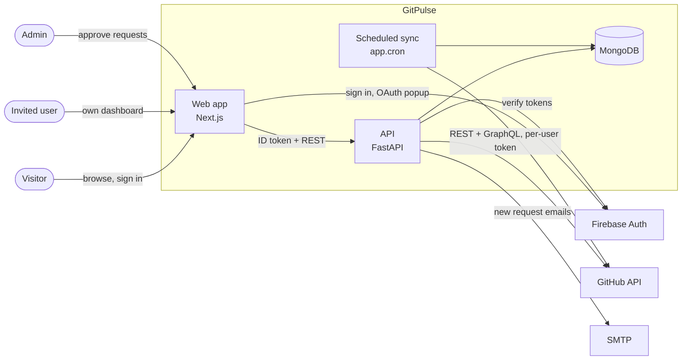
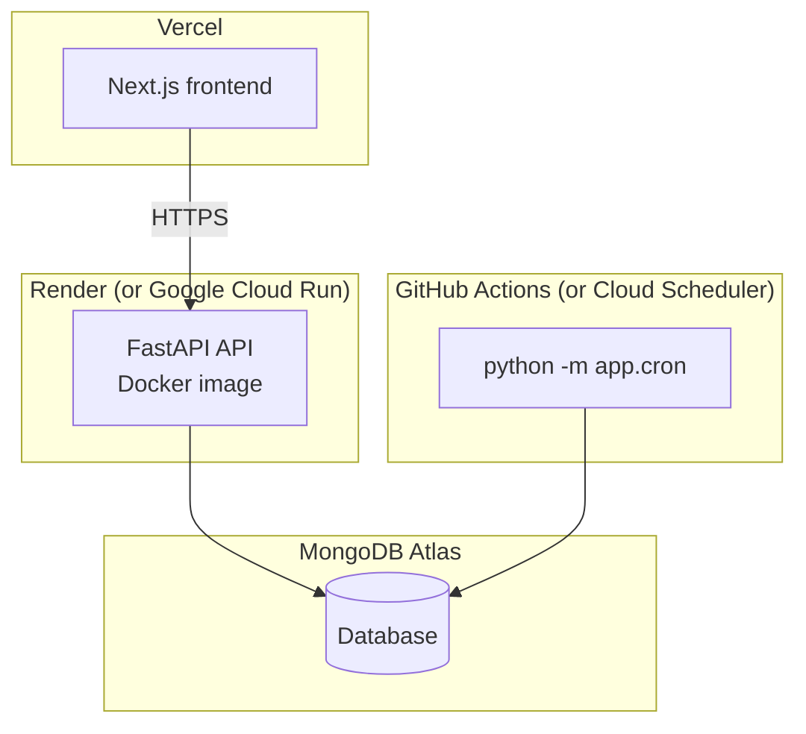

# High-Level Design

> **Scope:** what GitPulse is for, the requirements that shaped it, its major
> components and how they fit together, and the main design decisions with their
> trade-offs. For module-level detail see the [Low-Level Design](lld.md).

## 1. Problem

GitHub shows repository traffic (views, clones, referrers) for only the **last 14
days**, and it keeps no history of **who followed or unfollowed** you. Once a day
scrolls out of that window, the data is gone for good.

GitPulse records this data every day, so the history keeps growing: long-term
traffic, follower churn with timestamps, star growth and contribution trends on
one dashboard.

## 2. Requirements

### Functional

| # | Requirement |
|---|---|
| F1 | Users sign up with email and password, verify their email, and can reset a forgotten password. |
| F2 | Users connect their own GitHub account with one click (OAuth). No tokens are copied by hand. |
| F3 | The system syncs each connected account on a schedule and on demand. |
| F4 | Traffic is stored **day by day**, so history extends past GitHub's 14-day window. |
| F5 | Follower changes are recorded as timestamped events; renames are not counted as unfollows. |
| F6 | Access is **invite-only**: visitors request access; an admin approves, invites or removes people. |
| F7 | Any signed-in visitor can browse a **read-only demo** of the owner's real dashboard. |
| F8 | The owner is emailed when someone requests access. |

### Non-functional

| # | Requirement | How it's met |
|---|---|---|
| N1 | **Isolation:** a user can never see another user's data | Every query is scoped to the user centrally ([multi-tenancy](system-design/multi-tenancy.md)) |
| N2 | **Secrets at rest:** a database leak must not expose anyone's GitHub | GitHub tokens are encrypted ([security](system-design/security.md)) |
| N3 | **Low cost:** free tiers for a hobby-scale, invite-only app | Serverless and managed services; no always-on infrastructure required |
| N4 | **Resilience:** a GitHub hiccup must not wipe good data | Syncs keep previous values when a call fails ([sync engine](system-design/sync-engine.md)) |
| N5 | **Responsiveness:** the dashboard renders instantly | Cached reads from MongoDB, a persisted client cache, compressed responses |
| N6 | **Portability:** runs on Render or Google Cloud with the same code | One Docker image; configuration only through environment variables |

## 3. System context

## 4. Components

| Component | Responsibility | Technology |
|---|---|---|
| **Web app** | Landing page, auth screens, onboarding, dashboard, demo, admin | Next.js 15, React 19, TypeScript, Tailwind, TanStack Query |
| **Identity provider** | Accounts, passwords, email verification and reset, GitHub OAuth | Firebase Authentication |
| **API** | Verifies identity, enforces access, serves data, runs syncs | Python, FastAPI |
| **Sync engine** | Pulls GitHub data and turns it into history | Python services inside the API image |
| **Scheduler** | Runs the sync for every connected user, 4× a day | GitHub Actions cron (or Cloud Scheduler + Cloud Run Job) |
| **Database** | Users, invites, snapshots, events, daily traffic | MongoDB Atlas |
| **Mail** | Notifies the owner of access requests | Any SMTP server (e.g. Gmail) |

## 5. Key flows (summary)

Each flow is described step by step in [workflows.md](workflows.md).

1. **Visitor → demo:** sign up → verify email → read-only view of the owner's dashboard.
2. **Request → approval:** request form → owner emailed → approved at `/admin` → access immediately.
3. **Onboarding:** sign in → connect GitHub (OAuth popup) → first sync with live progress → dashboard.
4. **Scheduled sync:** cron → every connected user → snapshots, events and daily traffic updated.
5. **Every API request:** verify token → check invite → scope to the user → read their data.

## 6. Deployment topology

The same Docker image runs both the API and the scheduled sync. Terraform for a
Google Cloud deployment (Cloud Run, Cloud Scheduler, Secret Manager) lives in
[`infra/`](../infra/).

## 7. Design decisions

| Decision | Chosen | Alternatives | Why |
|---|---|---|---|
| Authentication | **Firebase Auth** | Custom JWT + OTP; Clerk | Handles password storage, verification and reset emails, and GitHub OAuth for free. The API only verifies tokens. |
| How users connect GitHub | **OAuth popup** (via Firebase) | Users paste a personal token | One click, no copying secrets around. Each user's own token means each gets their own GitHub rate limit. |
| Database | **MongoDB** | PostgreSQL | Snapshot and event documents map naturally to GitHub's JSON. Atlas has a free tier. |
| Multi-tenancy | **Shared collections + `owner_id`**, enforced centrally | Database per user | Simple to operate. One wrapper enforces isolation, so individual queries can't forget it. |
| Sync execution | **In-process background thread + cron job** | Job queue (Cloud Tasks / Redis) | Enough for an invite-only group. The queue is the planned next step for scale (see below). |
| Demo | **Same pages and endpoints, re-mounted read-only** | Static screenshots or a fake dataset | Always real and current, and no duplicate code to maintain. |
| Invite storage | **Database (`invites`)** | Environment variable list | Approvals take effect instantly, with no redeploy. |

## 8. Scalability

| Dimension | Today | Path to scale |
|---|---|---|
| Users | Invite-only, tens of users | Fine as is |
| Sync throughput | Users synced one after another | Queue with one task per user and parallel workers; skip repositories unchanged since last sync |
| GitHub rate limits | Each user's own token (5,000 calls/hour each) | Already scales per user |
| Storage | One star snapshot per repo per sync | Store a snapshot only when the count changes; archive old events |
| Read traffic | Indexed queries, every index led by `owner_id` | Horizontal API scaling (stateless) |

## 9. Out of scope (for now)

- Payments and plans
- AI analysis of repositories (shown as "Soon" on the landing page)
- Organisation accounts and team dashboards
