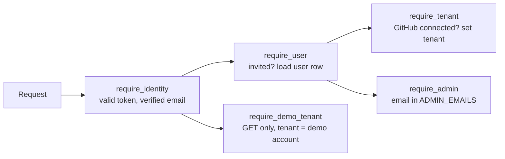

# Low-Level Design

> **Scope:** code structure, the API contract, the data schemas and the key
> algorithms. Read the [High-Level Design](hld.md) first for the big picture.

## 1. Backend modules

```
backend/app/
├── main.py              App assembly: middleware (CORS, gzip), routers, /demo mount, /health
├── config.py            All settings, from environment variables
├── database.py          Shared MongoClient (a connection pool), opened at startup
├── indexes.py           Index definitions, created at startup
├── tenant.py            Tenant context + ScopedCollection (per-user isolation)
├── access.py            Invite-only rules, access requests, invites
├── demo.py              Demo tenant resolution + read-only guard
├── github_account.py    Connect/disconnect GitHub, token storage, legacy adoption
├── notify.py            SMTP email to the owner
├── cron.py              Entry point for scheduled syncs (python -m app.cron)
├── scheduler.py         Optional in-process hourly follower sync
├── auth/
│   ├── firebase.py      Firebase ID-token verification (Google public keys)
│   ├── deps.py          FastAPI guards: require_identity → require_user → require_tenant / require_admin
│   ├── users.py         The app's user record for each Firebase account
│   └── crypto.py        Token encryption (Fernet)
├── routes/              HTTP endpoints (thin: validate, call a service, shape the response)
│   ├── auth.py          /api/auth/me, /api/github/*
│   ├── access.py        /api/access/*, /api/admin/*
│   ├── followers.py     /api/profile, /api/sync*, /api/followers*, /api/following
│   ├── repos.py         /api/repos*
│   └── contributions.py /api/contributions*
└── services/            Business logic, all reading through tenant_db()
    ├── github_service.py        GitHub REST/GraphQL client (current user's token)
    ├── follower_service.py      Follower diffing, events, unfollower queries
    ├── following_service.py     Following list
    ├── repo_service.py          Repo stats, daily traffic store, overview aggregations
    ├── contributions_service.py Contribution calendars per year
    ├── profile_service.py       Cached GitHub profile
    ├── sync_state.py            "Last synced" marker (polled by the browser)
    └── sync_runner.py           Full sync orchestration + background jobs
```

**Layering rule:** routes → services → `tenant_db()` → MongoDB. Services never
receive a user id as a parameter. They read it from the tenant context, so
scoping can't be skipped by mistake.

## 2. Request guards (dependency chain)



| Guard | Fails with |
|---|---|
| `require_identity` | `401 not_authenticated` / `401 token_invalid` / `403 email_not_verified` / `503 auth_unavailable` |
| `require_user` | `403 not_invited` |
| `require_tenant` | `409 github_not_connected` / `409 github_reconnect_required` |
| `require_admin` | `403 not_admin` |
| `require_demo_tenant` | `403 demo_read_only` / `404 demo_unavailable` |

Errors use one shape: `{"detail": {"code": "...", "message": "..."}}`. The
frontend switches on `code` and shows `message`.

## 3. API reference

### Identity and onboarding

| Method | Path | Guard | Purpose |
|---|---|---|---|
| GET | `/api/auth/me` | user | Profile, GitHub connection, sync job, `last_synced_at`, `is_admin` |
| POST | `/api/github/connect` | user | Body `{access_token}` from the OAuth popup. Verified with GitHub, encrypted and stored, first sync started. |
| GET | `/api/github/sync` | user | Background sync progress `{status, step, steps[], error}` |
| POST | `/api/github/sync` | user | Start a background sync (`409` if one is running) |
| POST | `/api/github/disconnect` | user | Remove the stored token (history is kept) |

### Invite-only program

| Method | Path | Guard | Purpose |
|---|---|---|---|
| POST | `/api/access/request` | **public** | `{email, note, name?, github?}`. Same response whether or not the email is invited; rate-limited. |
| GET | `/api/access/status` | identity | `{has_access, request}` for the signed-in account |
| GET | `/api/admin/requests?status=` | admin | List requests (pending / approved / rejected) |
| POST | `/api/admin/requests/{id}/approve` | admin | Approve and invite |
| POST | `/api/admin/requests/{id}/reject` | admin | Reject |
| GET | `/api/admin/members` | admin | Everyone with access, with sign-up and GitHub status |
| POST | `/api/admin/invites` | admin | Invite an email directly |
| DELETE | `/api/admin/invites/{email}` | admin | Remove access (immediate) |

### Dashboard data (guard: tenant; also mounted read-only under `/demo/api/*`)

| Method | Path | Returns |
|---|---|---|
| GET | `/api/profile` | Cached GitHub profile (`?refresh=1` forces a refetch) |
| GET | `/api/sync-status` | `{last_sync_at}`, polled by open tabs |
| POST | `/api/sync` | Full sync, inline |
| GET | `/api/followers` | Current followers (paginated, searchable) |
| GET | `/api/followers/stats` | Totals |
| GET | `/api/followers/unfollowed` | People who left and haven't come back |
| GET | `/api/followers/{login}/history` | Follow/unfollow timeline for one person |
| GET | `/api/following` | Accounts you follow, in GitHub's order |
| GET | `/api/repos` | Repositories (paginated, sortable, filterable) |
| GET | `/api/repos/overview` | Totals, languages, top repositories |
| GET | `/api/repos/{name}` | One repository |
| GET | `/api/repos/{name}/traffic` | Daily views/clones, all recorded history |
| GET | `/api/repos/{name}/star-history` | Stars over time |
| GET | `/api/contributions` | Per-year totals (`?with_latest=true` embeds the newest year) |
| GET | `/api/contributions/{year}` | Full calendar for one year |

### Other

| Method | Path | Purpose |
|---|---|---|
| GET | `/api/demo` | Public profile of the demo account (for the demo banner) |
| GET | `/health` | Liveness. Never touches the database. |

## 4. Data schemas

All per-user collections carry `owner_id: ObjectId` (→ `users._id`), and every
index on them starts with `owner_id`.

### `users`
```
_id            ObjectId
firebase_uid   string     unique: the Firebase account
email          string     lower-cased, verified by Firebase
name           string
created_at     datetime
last_seen_at   datetime   updated at most hourly
github {                  present once connected
  id           int        unique: one GitPulse account per GitHub account
  login        string
  name, avatar_url
  token_enc    string     Fernet-encrypted OAuth token
  scopes       [string]
  connected_at datetime
}
```

### Invite-only program
```
invites          { _id: email, invited_at, invited_by, source: "request" | "direct" }
access_requests  { email (unique), name, github, note,
                   status: "pending" | "approved" | "rejected", created_at, decided_at }
rate_limits      { _id: "<key>|<window>", count, expires_at }   TTL-expired
sync_jobs        { _id: user_id, status: "running" | "done" | "failed",
                   step, started_at, finished_at, error }
```

### GitHub data (per user)
```
follower_snapshots  { owner_id, github_id, login, name, avatar_url, html_url,
                      captured_at, previous_logins[], is_initial }
follower_events     { owner_id, github_id, login, name, avatar_url, html_url,
                      event_type: "followed" | "unfollowed", event_at }
following_snapshots { owner_id, github_id, login, name, avatar_url, html_url,
                      position, captured_at }
repo_snapshots      { owner_id, name, full_name, description, is_private, is_fork,
                      stars, forks, watchers, languages{}, topics[],
                      commits_total, commits_last_year, branches,
                      traffic_views_total, traffic_clones_total,          ← GitHub's 14 days
                      views_all_time, clones_all_time, traffic_days_recorded, ← accumulated
                      referrers[], popular_paths[], pushed_at, synced_at }
traffic_daily       { owner_id, repo, date: "YYYY-MM-DD", views, views_uniques,
                      clones, clones_uniques }                   unique (owner_id, repo, date)
star_snapshots      { owner_id, repo, stars, captured_at }
contributions       { owner_id, year, total_contributions, total_commits, total_prs,
                      total_issues, total_reviews, weeks[] }      unique (owner_id, year)
meta                { _id: "sync:<user_id>" | "profile:<user_id>", ... }
```

## 5. Key algorithms

### 5.1 Tenant scoping (`tenant.py`)

```python
class ScopedCollection:
    def _f(self, filter):                       # applied to every read and write
        filter["owner_id"] = current().user_id  # current() raises if no tenant is set
        filter |= visibility_filter()           # demo only: hide private repos
        return filter
    def aggregate(self, pipeline):              # aggregations get a leading $match
        return col.aggregate([{"$match": self._f({})}, *pipeline])
```

The tenant is stored in a `ContextVar`. `require_tenant` is an **async**
dependency, so it runs in the request's own context; the sync endpoint then runs
in a worker thread that inherits a copy of that context. Background jobs set it
explicitly with `with use(tenant):`.

### 5.2 Follower diff (`follower_service.sync_followers`)

```
current = GitHub followers, keyed by immutable github_id
stored  = follower_snapshots, keyed by github_id
new     = current − stored  → insert snapshot + "followed" event
lost    = stored − current  → delete snapshot + "unfollowed" event
both    = login changed?    → update login, add old one to previous_logins (no event)
guard   : GitHub returns 0 while we have many → abort (protects against a bad response)
```

"Unfollowed" lists show each person's latest unfollow, minus anyone who has
since re-followed, matched by id first and by login as a fallback.

### 5.3 Traffic accumulation (`repo_service`)

GitHub returns the last 14 days of views and clones. Each day is **upserted**
into `traffic_daily` on `(owner_id, repo, date)`: overlapping syncs correct a day
instead of double-counting it, and days that leave GitHub's window stay stored.
Lifetime totals are a `$sum` over everything stored.

### 5.4 Token verification (`auth/firebase.py`)

1. Fetch the signing key for the token's `kid` from Google's JWKS endpoint (cached for an hour).
2. `jwt.decode` with the algorithm **pinned** to RS256, audience = project id,
   issuer = `https://securetoken.google.com/<project id>`, 30 s leeway.
3. Require `sub`; reject an `auth_time` in the future.
4. Key server unreachable → `503`, not `401`, so users aren't signed out by a network blip.

### 5.5 Background sync job (`sync_runner.start_job`)

Starting a job is one atomic upsert on `sync_jobs` that only matches when no job
is running for that user (or the running one is over 30 minutes old, i.e. died
with a restart). A duplicate start collides on `_id` and returns "already
running". The job runs in a daemon thread under `with use(tenant)` and writes its
current `step` as it goes. That's what the progress screen polls.

### 5.6 Legacy adoption (`github_account.adopt_legacy_data`)

Data from the single-user era has no `owner_id`. When someone connects the
GitHub account named in `GITHUB_USERNAME`, a one-time claim document
(`meta.legacy_owner`) records them as the owner, and all unowned records are
assigned to them. A later account using the same username can't claim it.

## 6. Frontend structure

```
src/app/
├── page.tsx                  Landing (request access, view demo)
├── (auth)/                   login, signup, verify-email, forgot-password
├── connect/                  Connect GitHub + first-sync progress
├── (app)/layout.tsx          Guard for the user's own dashboard
│   ├── dashboard, audience, repositories
│   └── admin/                Access requests + members (admins only)
└── demo/layout.tsx           Guard for the demo + separate query cache
    └── dashboard, audience, repositories   (re-exports of the (app) pages)

src/components/
├── auth/        AuthProvider (session state machine), auth page layout and form inputs
├── access/      Request-access form/dialog, invite-only screen
├── demo/        Demo banner
├── shell/       AppShell, sidebar, top bar
└── dashboard/, repos/, audience/, landing/, ui/

src/lib/
├── firebase.ts  Firebase init + GitHub OAuth popup
├── auth.ts      authFetch (attaches token, retries once on 401), API clients
├── api.ts       Dashboard API client (switches to /demo/api on /demo pages)
├── hooks.ts     TanStack Query hooks
└── paths.ts     useBasePath(): "" or "/demo"
```

**Auth state machine** (`AuthProvider`):
`loading → anonymous | unverified | forbidden | authenticated`. Each layout maps
these states to a redirect or a screen (see [workflows.md](workflows.md)).
