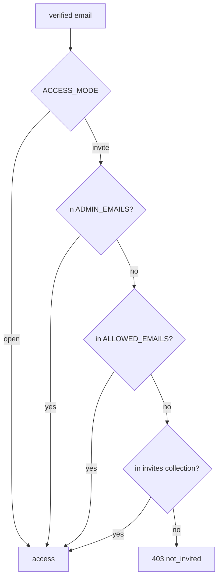

# System Design: Invite-Only Access

## Goal

Let anyone discover GitPulse and ask to join, while the owner decides who gets a
dashboard, without redeploying anything.

## Model

Firebase lets anyone create an account. **Having an account is not the same as
having access.** The API decides access on every request (`backend/app/access.py`):



| Source | Set by | Takes effect |
|---|---|---|
| `ADMIN_EMAILS` | Configuration | On restart; admins always have access and can open `/admin` |
| `ALLOWED_EMAILS` | Configuration | On restart (rarely needed) |
| `invites` collection | Admin page | **Immediately** |

Because the check runs on every request, removing someone locks them out on their
next click.

## Access requests

| Rule | Why |
|---|---|
| The form is **public** (no account needed) | Lowest-friction way to express interest |
| Identical response whether or not the email is already invited | Doesn't reveal who's a member |
| 5 requests per IP per hour | Stops spam (counters in `rate_limits`, auto-expired) |
| One request per email; re-submitting while pending only updates the note | No duplicates, no repeat emails |
| A new request (or a new one after a rejection) emails the owner | Owner hears about it without checking the app |

**Email:** sent over SMTP from a background task **after** the response, so a
slow mail server never delays the visitor. Reply-To is the requester, so replying
answers them directly. Without SMTP, requests still appear on `/admin`.

## Admin page (`/admin`)

| Action | Effect |
|---|---|
| Approve request | `invites` entry created (`source: request`), request marked approved |
| Reject request | Request marked rejected; the person can ask again |
| Invite by email | `invites` entry created (`source: direct`); any pending request is settled |
| Remove | Invite deleted, request marked rejected. Admins can't be removed here. |

Members show whether each person has signed up, their connected GitHub account
and when they were last seen. Only `require_admin` routes serve this, and the
sidebar link only appears for admins (the API enforces it regardless).

## Data

```
invites          { _id: email, invited_at, invited_by, source }
access_requests  { email, name, github, note, status, created_at, decided_at }
rate_limits      { _id, count, expires_at }            (TTL index)
```

## Verification

`backend/tests/test_access.py` covers the full request → approve → access →
remove cycle, admin-only routes, rejection, the non-revealing response, rate
limiting, admin protection and the one-email-per-request rule.
