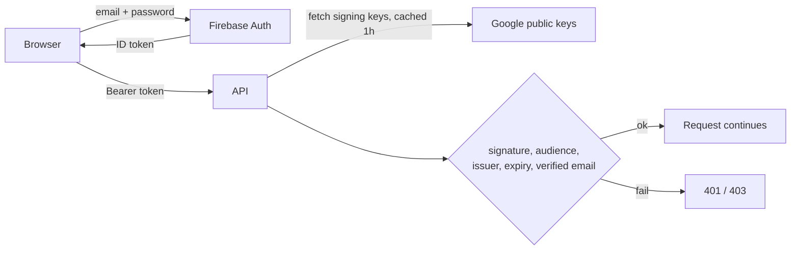
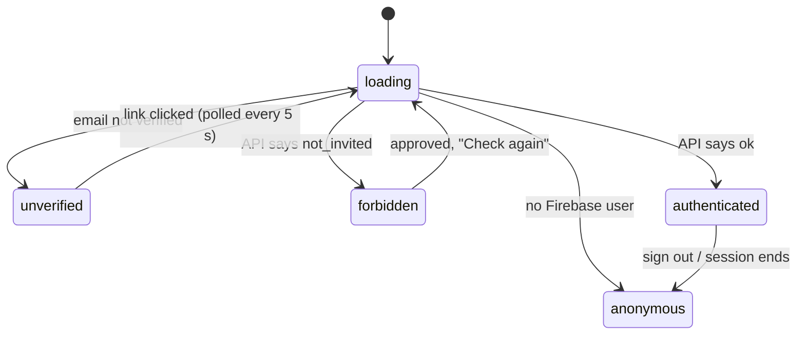

# System Design: Authentication

## Goal

Know **who** is calling the API, with verified email addresses, without GitPulse
ever storing passwords.

## Design

Identity is delegated to **Firebase Authentication**. The browser signs in with
Firebase and receives a short-lived **ID token** (a JWT, ~1 hour, refreshed
automatically by the Firebase SDK). Every API call sends it as
`Authorization: Bearer <token>`, and the API verifies it on each request. The API
keeps no sessions of its own.

## What Firebase handles

| Capability | Notes |
|---|---|
| Sign-up / sign-in | Email + password; the password policy is set in the Firebase console and mirrored live on the sign-up form |
| Email verification | A link is emailed; the app polls until the email is verified, then continues |
| Password reset | A link is emailed; reset happens on Firebase's page |
| Enumeration protection | Sign-in and reset don't reveal whether an email exists |
| GitHub OAuth | The "Connect GitHub" popup (see [multi-tenancy](multi-tenancy.md)) |

## Token verification in the API

Implemented in `backend/app/auth/firebase.py` with PyJWT, following Firebase's
documented rules for third-party JWT libraries:

| Check | Value |
|---|---|
| Signature | RS256 against Google's published keys; algorithm **pinned**, never read from the token |
| Audience (`aud`) | The Firebase project id |
| Issuer (`iss`) | `https://securetoken.google.com/<project id>` |
| Expiry / issued-at | Required, 30-second clock leeway |
| `auth_time` | Present and not in the future |
| `sub` | Non-empty (the Firebase uid) |
| `email_verified` | Must be true (checked in `require_identity`) |

No service-account key is needed: verification uses only public keys and the
project id. If Google's key endpoint is unreachable, the API answers **503**
instead of 401, so a network hiccup doesn't sign users out.

## Session handling in the browser

`AuthProvider` (frontend) holds a small state machine driven by Firebase's
`onAuthStateChanged` and the API's `/api/auth/me`:

`authFetch` attaches the current token to each request. On a 401 it forces one
token refresh and retries once; a second 401 ends the session. Signing out also
clears the cached dashboard data from the browser.

## Why not a custom auth system?

An earlier version used its own JWTs, Argon2 password hashing and email OTP
codes. Firebase replaced it to remove password storage, email delivery and
security upkeep from the codebase, and because it also provides GitHub OAuth.
