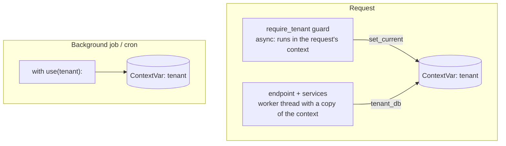
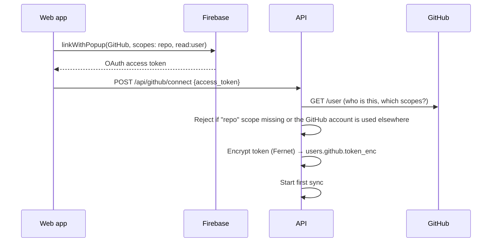

# System Design: Multi-Tenancy and GitHub Connections

## Goal

Many users share one database, and **no user can ever read or change another
user's data**, even if a developer forgets a filter in a new query.

## Approach: shared collections, central enforcement

Every GitHub-data document carries `owner_id`. Instead of trusting each query to
include it, services get collections only through `tenant_db()`, which returns a
`ScopedCollection` wrapper that adds the owner to everything:

| Operation | What the wrapper does |
|---|---|
| `find`, `find_one`, `count_documents` | adds `owner_id = current user` to the filter |
| `update_*`, `replace_one`, `delete_*` | same; on upsert the owner is written into the new document |
| `insert_one`, `insert_many` | stamps `owner_id` onto each document |
| `aggregate` | prepends `{$match: {owner_id: …}}` |
| a filter naming a **different** `owner_id` | raises `PermissionError` |
| anything not listed above | not exposed, so it can't bypass the scope |

The "current user" (tenant) lives in a Python `ContextVar`:

If code touches `tenant_db()` with **no** tenant set, it raises `NoTenant`. It
fails closed instead of returning everyone's data.

**Indexes** all start with `owner_id`, which serves the always-present filter and
makes uniqueness per user. For example, two users can each have a repository
called `portfolio`.

## Connecting GitHub

- Each user's **own** token is used for their syncs, so every user has their own
  GitHub rate limit (5,000 requests/hour).
- Tokens are encrypted at rest with `TOKEN_ENCRYPTION_KEY`. If the key changes,
  stored tokens can't be decrypted and users are asked to reconnect.
- A unique index on `users.github.id` keeps one GitPulse account per GitHub account.
- Disconnecting removes the token but keeps the history, so reconnecting picks up
  where it left off.

## Migrating single-user data

GitPulse started as a single-user app, and its data had no `owner_id`. When the
GitHub account named in `GITHUB_USERNAME` is connected, that account becomes the
**legacy owner** (recorded once, so it can't be claimed again later) and all
unowned records are assigned to it. This runs at connect time, so the history is
visible immediately, and again on each of that owner's syncs to pick up stragglers.

## Verification

`backend/tests/test_tenancy.py` checks through real HTTP requests that:
users only see their own repos and totals, aggregations are scoped, data routes
require a connected GitHub account, the wrapper refuses another owner's id, and
legacy data goes only to the right account.
