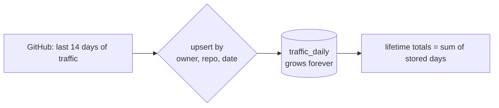

# System Design: Sync Engine

## Goal

Turn GitHub's "current state only" APIs into a **growing history**, reliably, for
every connected user.

## What a sync does

One full sync for one user (`services/sync_runner.run_full_sync`):

| Step | GitHub calls | Stored as |
|---|---|---|
| 1. Profile | `GET /user` | `meta.profile:<user>` (cached 6 h; served instantly to every page) |
| 2. Followers | `GET /users/{login}/followers` (paged) + GraphQL names | `follower_snapshots` + `follower_events` (diff) |
| 3. Following | `GET /user/following` (paged) + GraphQL names | `following_snapshots` (order kept, "first seen" preserved) |
| 4. Repositories | `GET /user/repos`, then per repo: languages, traffic views/clones, referrers, popular paths, commit activity, commit count, branches, watchers | `repo_snapshots`, `traffic_daily`, `star_snapshots` |
| 5. Contributions | GraphQL `contributionsCollection` per year since the account was created | `contributions` |

Finally `meta.sync:<user>` is stamped. Open browser tabs poll that timestamp and
refresh when it moves.

## Turning snapshots into history

- **Traffic:** each day is upserted on `(owner, repo, date)`. Re-syncing the same
  window corrects a day instead of adding it twice; days that drop out of
  GitHub's window stay stored.
- **Followers:** the current list is diffed against the stored one by **GitHub
  user id**. Joins become `followed` events and departures become `unfollowed`
  events. A changed login is recorded as a rename, never as an unfollow.
- **Stars:** a snapshot per repository per sync gives star history.

## Reliability rules

| Situation | Behaviour |
|---|---|
| A per-repo call fails or GitHub is still computing stats (`202`) | Keep the previous value; it fills in next time. Never write a misleading `0`. |
| Traffic denied (`403`, missing scope) | Counted and logged with the fix; other data still syncs |
| GitHub suddenly returns **zero** followers while many are stored | Abort the follower step to protect the stored data |
| Token revoked (`401`) | Job fails with "Reconnect your GitHub account" |
| Rate limit (`403` on the user call) | Job fails with a retry-later message |
| One user fails during the scheduled run | Logged and skipped; the others continue |

## When syncs run

| Trigger | Mechanism | Notes |
|---|---|---|
| Right after connecting GitHub | Background thread in the API (`sync_jobs` tracks progress) | One job per user at a time, enforced atomically; a job stuck for 30 min is treated as dead |
| "Sync" button | Inline request | |
| Hourly | In-process scheduler, followers only | `ENABLE_SCHEDULER` |
| 4× daily | `python -m app.cron` from GitHub Actions or a Cloud Run Job | Every connected user |

## Cost and scale

A sync is mostly **waiting on GitHub** (several calls per repository), so its
cost is time, not CPU. Measured on a real account: about 10 minutes for 83
repositories and 1,500 followers.

Planned improvements for larger user counts:

1. **Queue per user** (e.g. Cloud Tasks) with parallel workers instead of a loop.
2. **Skip unchanged repositories**: only fetch details for repos pushed since the
   last sync; fetch traffic once a day.
3. **Several syncs per worker at once**, since they're I/O-bound.
4. **Star snapshots only on change**, to slow storage growth.
