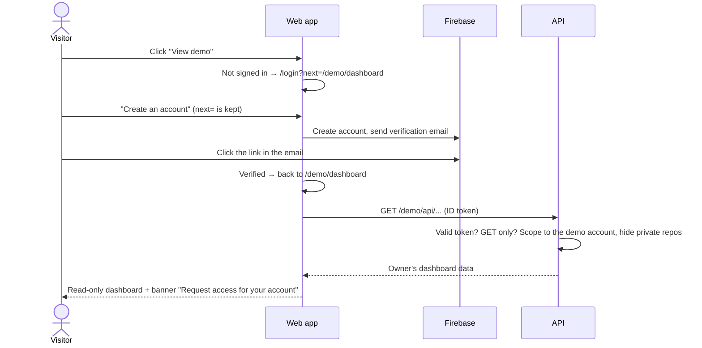
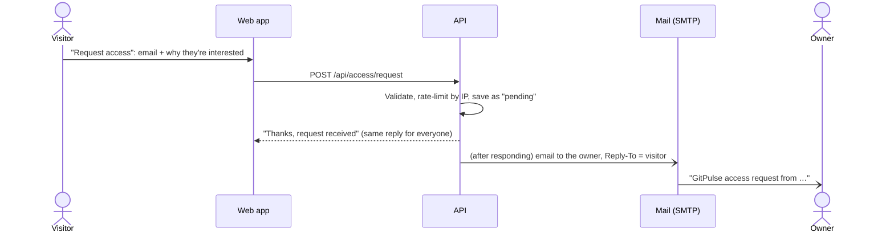
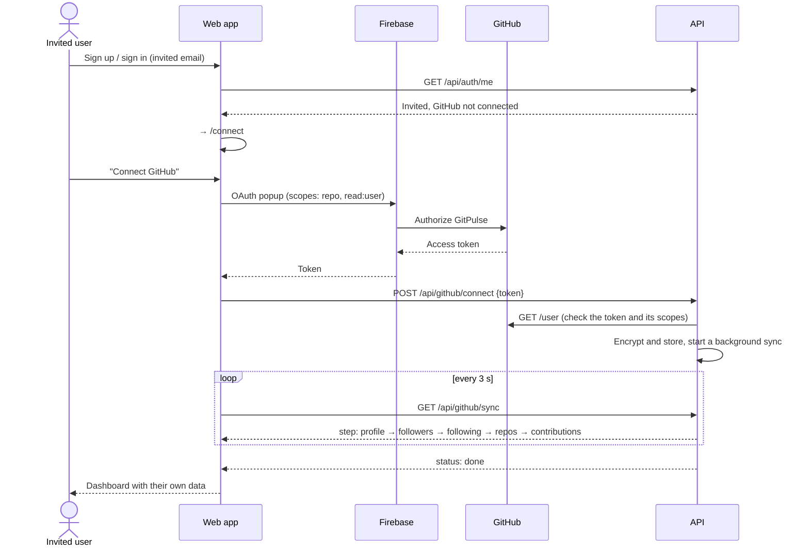
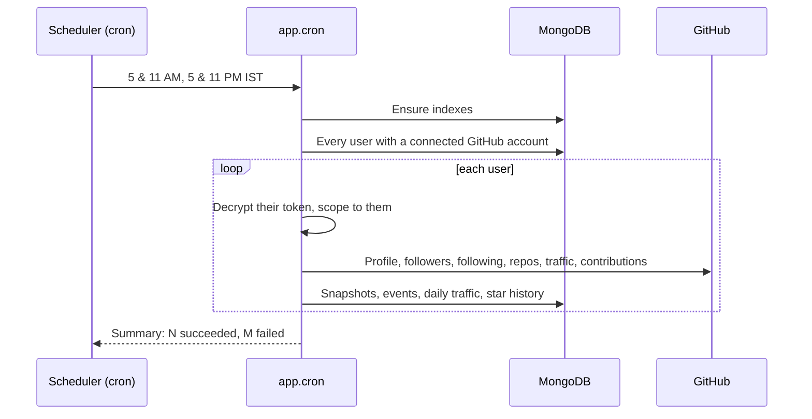

# Workflows

Every journey through GitPulse, step by step: what the person sees and what the
system does underneath. Components are described in the [HLD](hld.md); endpoints
and schemas in the [LLD](lld.md).

| # | Workflow | Who |
|---|---|---|
| 1 | [Visitor views the demo](#1-visitor-views-the-demo) | Anyone |
| 2 | [Requesting access](#2-requesting-access) | Anyone |
| 3 | [Approving or removing access](#3-approving-or-removing-access) | Admin |
| 4 | [First sign-in and connecting GitHub](#4-first-sign-in-and-connecting-github) | Invited user |
| 5 | [Using the dashboard](#5-using-the-dashboard) | Invited user |
| 6 | [Scheduled sync](#6-scheduled-sync) | System |
| 7 | [Forgot password](#7-forgot-password) | Any account |
| 8 | [Where each person lands](#8-where-each-person-lands) | Everyone |

---

## 1. Visitor views the demo

**Goal:** let anyone explore a real GitPulse dashboard before asking for access.

- Works for **any** verified account, invited or not.
- Read-only: no Sync button, and any non-GET request is refused by the API.
- Private repositories of the demo account are filtered out on the server.

## 2. Requesting access

**Goal:** turn an interested visitor into a request the owner can act on.

- The response never reveals whether an email is already invited.
- Re-submitting while pending updates the note but doesn't email again.
- Without SMTP configured, the request still appears on `/admin`.
- Signed-in visitors without an invite see the same form, pre-filled, on the
  "invite-only" screen. If they've already asked, they see **Request pending**.

## 3. Approving or removing access

**Goal:** the owner decides who gets a dashboard, with immediate effect.

1. The admin opens **Access** in the sidebar (`/admin`, admins only).
2. **Access requests**: each shows the email, note and time. **Approve**
   adds the email to `invites`; **Reject** marks the request rejected.
3. **Members**: everyone with access, whether they've signed up, their GitHub
   account and when they were last seen. **Invite** by email directly, or
   **Remove** someone.
4. No restart is needed: access is checked on every request, so the next page
   load reflects the change. Approved people aren't emailed automatically, so the
   owner lets them know (replying to the request email is the quickest way).

## 4. First sign-in and connecting GitHub

**Goal:** go from a fresh invite to a populated dashboard.

- `repo` is requested because GitHub only shares traffic with that scope.
  GitPulse never writes to GitHub.
- A GitHub account can be connected to only one GitPulse account.
- The first sync takes from under a minute to around 10 minutes, depending on
  the number of repositories. The page shows each step as it happens.

## 5. Using the dashboard

- **Overview**: totals, traffic and follower charts, top repositories, contribution heatmap.
- **Audience**: followers, following, and people who unfollowed, with each
  person's follow/unfollow history.
- **Repositories**: sortable table; open a repository for daily traffic, referrers,
  popular files and star history.
- **Sync**: refreshes everything now. Open tabs notice syncs that ran elsewhere
  (scheduled or another tab) by polling `/api/sync-status`, and refresh themselves.

Data shown on load comes from the browser's saved cache (so it appears instantly)
and is refreshed in the background.

## 6. Scheduled sync

**Goal:** keep everyone's history growing without anyone being online.

- One user's failure (revoked token, rate limit) is logged and skipped; it never
  stops the others.
- A failed GitHub call never overwrites a stored value with zero. The previous
  value is kept until the next successful sync.
- Days are upserted, so overlapping runs never double-count traffic.

## 7. Forgot password

1. **Forgot password?** on the sign-in page → enter the email.
2. Firebase emails a reset link. The page says the same thing whether or not the
   account exists.
3. The link opens Firebase's reset page → new password → sign in again.

## 8. Where each person lands

| Situation | Landing page | `/demo/*` | `/dashboard` |
|---|---|---|---|
| Not signed in | Request access, View demo, Sign in | → sign in, then back | → sign in, then back |
| Email not verified | | → verify, then back | → verify |
| Signed in, not invited | | ✅ read-only demo | "Invite-only" screen: request form or "pending", plus a demo link |
| Invited, GitHub not connected | | ✅ | → `/connect` |
| Invited, first sync running | | ✅ | → `/connect` progress |
| Invited, has data | | ✅ | ✅ their dashboard |
| Admin | | ✅ | ✅ plus **Access** in the sidebar |
